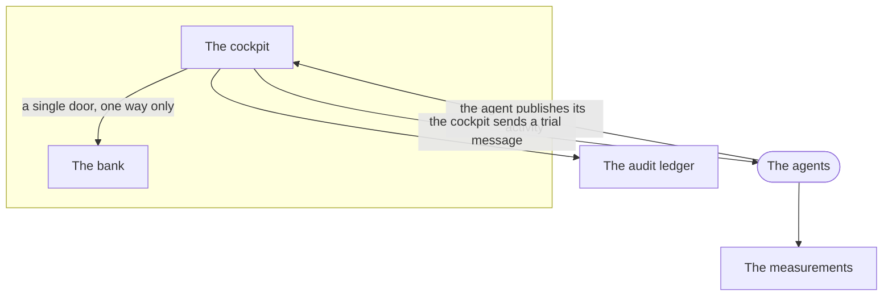

<div align="center">

# Tessera

**A multilingual (FR / DE / EN) banking support LLM agent for the European retail market.**

Grounded in EU regulatory corpora (DORA, CNIL, BaFin, GDPR).
Guarded at runtime by a first-party, policy-driven guard at a single tool-call chokepoint — every decision audited, its efficacy measured (ADR 0028).
Validated by a non-regression harness over 63 publicly documented agent failures.
Deployed on Google Cloud Run with an alternate on-premises mode running Llama 3.3 70B locally on Apple Silicon.

[](https://github.com/AmadouMamane/tessera/actions/workflows/ci.yml)
[](https://github.com/AmadouMamane/tessera/actions/workflows/eval.yml)
[](https://github.com/AmadouMamane/tessera/actions/workflows/security.yml)
[](./LICENSE)
[](https://www.python.org/downloads/)
[](https://mypy.readthedocs.io/)
[](https://docs.astral.sh/ruff/)

</div>

---

## Understand it in 3 minutes

The same explanation the running cockpit gives a visitor, at `/comprendre` — in French,
German and English. Condensed here for whoever arrives by the repository instead.



**What is Tessera?** A control tower for a bank's AI agents. Picture a bank employing several
AI assistants — one answers customer questions, one guides account openings, one handles
overdue payments — built by different teams, sometimes on different technologies. Someone
must still be able to answer three questions: what are these agents doing, are they doing it
well, and can you prove it to an auditor? The bank you see, Crédit Aurore, is fictional.
Everything else works for real, and whenever something is simulated the screen says so.

**The two worlds.** The business spaces are the bank as its customers and advisors live it.
The cockpit is the engine room: the fleet, its signals, its evidence. They communicate
through a single door, in a single direction — the operator may go see what customers
experience; the reverse is impossible.

**How Tessera observes agents.** Every agent publishes the story of its activity; the cockpit
never reaches inside one. Much like a Holter monitor, the sensor records the heart without
touching it. It does not matter who built the agent: `examples/hello-agent/` was written
without a single line of this project, and its level badge is computed from real
measurements anyway. Full onboarding, timed: **twenty minutes and eighteen seconds**.

**How Tessera tests agents.** Observing is not always enough — an agent silent for two hours
may be healthy or down. So an agent may declare a test door, and the operator sends it a
trial message; a canary does the same on a schedule, so silence never means "we don't know".
Every trial is authenticated, recorded in the audit ledger, and marked synthetic, so a test
is never counted as a real customer. In production, Tessera watches everything, touches
almost nothing, and forgets nothing.

**Why some agents serve no clients.** `hello-agent`, `turn-agent` and `duplex-agent` are
platform witnesses. Hello proves a foreign agent can be *observed*; Turn proves one can be
*tested*; Duplex proves the two *combine* — you prompt it, it acts, its activity shows up,
and its trust level rises because it was tested. Their bareness is the proof: if the
observable witness needed to be testable in order to work, the demonstration would prove
nothing.

**What is real, and what is merely declared.** A number on screen is a number that was
measured. Missing data renders as a dash with a reason — never a fake zero, never an invented
score. On the fleet's badges, "L1 computed" rests on real measurements; "L2 declared · no
evidence" means the agent announces capabilities the platform has not yet verified. The gap
is displayed, not hidden.

**The two memories.** The first records *what the agents do* — conversations, measurements,
business events — and feeds the dashboards. The second records *what we decide about them*:
this reply validated, this message blocked, this agent tested on Tuesday at 2:07 pm. That is
the audit ledger, each entry chained to the previous one so none can be altered without it
showing. It is what you hand an auditor.

**Going further.** Every architecture decision is written down, dated and argued in
[`docs/decisions/`](docs/decisions/) — including the mistakes and their corrections, because
a system that documents only its successes documents nothing.

---

## Positioning

Tessera is a **complete, opinionated, deployed assembly** of four quality layers — runtime guard, offline regression harness, structured audit trail, and human-in-the-loop escalation — wired end to end for one specific, demanding use case: **European retail banking customer support in three languages (FR / DE / EN) with explicit regulatory grounding** (DORA, CNIL, BaFin, GDPR).

It builds deliberately on proven components rather than reinventing them:

- A first-party runtime guard behind a single declared seam (`src/tessera/guard/adapter.py`); [`mcp-firewall`](https://github.com/ressl/mcp-firewall) is cited as prior art for the category (ADR 0028).
- A non-regression harness whose patterns draw on [AgentAssay](https://github.com/agentassay) and [Promptfoo](https://github.com/promptfoo/promptfoo).
- An audit-trail design informed by the AEGIS research line.

The engineering work is the end-to-end integration and the EU banking domain semantics: multilingual regulatory retrieval, deterministic policy short-circuits on the critical failure cases, a per-model evaluation scorecard, and a production deployment with an on-premises fallback.

### Built on / inspired by

| Project / Paper        | Role                                          |
| ---------------------- | --------------------------------------------- |
| [`mcp-firewall`](https://github.com/ressl/mcp-firewall) (ressl) | Guard-category prior art (ADR 0028) |
| AEGIS                  | Audit-trail design pattern                    |
| DFAH                   | Failure taxonomy for agent harnesses          |
| AgentAssay             | Regression-test scaffolding patterns          |
| Promptfoo              | YAML-driven prompt evaluation / interop       |
| STING                  | Tool-use stress testing                       |
| Bernstein              | Multilingual evaluation framing               |
| ALTK                   | Agent-level toolkit comparisons               |

Academic citations in [`docs/differentiation.md`](./docs/differentiation.md) are verified against the source papers.

---

## What's working, what isn't

This section reports the real test status, not a marketing surface. Failures are documented, not hidden.

### Green in CI — the gate

One job decides whether a commit is green, and it is the same command you run on your machine:

```bash
make gate      # run it twice; a check that passes once and fails once is a red check
```

`make gate` is the definition, `.github/workflows/ci.yml` job `gate` is a caller — there is no second, drifting copy of the command list. It is hermetic: no secrets, no services, no browser.

- **Python — 1,573 tests pass** (`pytest -m "not integration"`). Agent graph, router/policy deterministic short-circuits (including the policy/scope refusal guard, the third-party-PII guard, the auth redirect and the DORA corrections with their false-positive contracts), retrieval, guard, corpus generation, the LLM router, the memory tiers (window / summary / persistent / entity ledger / governance), and reasoning-trace stripping. Plus `ruff check`, `ruff format --check`, `mypy --strict`.
- **Frontend — 132 tests pass** (`vitest run`), plus `tsc --noEmit` and `biome check`, with `pnpm` pinned by `packageManager` (9.15.0).
- **Security workflow.** `bandit`, `pip-audit`, Trivy. The supply-chain workflow builds, signs (cosign), and attaches SLSA provenance + an SBOM to the agent image.

Until 2026-07-10 this section claimed the frontend `biome` and `tsc` ran in CI. They did not — no workflow invoked `pnpm`, `biome`, `tsc`, `vitest` or Playwright, so the entire frontend could rot without a witness. The `gate` job is what makes the claim true.

### Not gating CI (needs live services)

- **End-to-end suite** (`webapp/frontend/e2e/`, Playwright). The `e2e` job runs it against a **production build** (`next build` + `next start`), one worker, with PostgreSQL from a service container. Against a seeded local stack the suite is **182 passed / 0 failed / 0 skipped**, twice in a row. On the bare runner it is **160 / 19 / 2**, and those 19 are an empty database, not spec debt: the catalogue expects 17 sources and finds the 2 memory tables, because the fifteen corpus categories live in a pgvector index the runner has never been fed. So the job stays **non-blocking**. It flips when CI gets a seeded dataset — which needs embeddings, hence a model, hence a secret the gate must never hold. Narrowing the job to the data-independent subset would be a weaker gate wearing the name of the gate, and that is not something we do.
- **Integration suite** (`tests/integration/`, `pytest.mark.integration`) exercises the full graph and the persistent memory backend. A subset needs a seeded PostgreSQL and a live LLM (Ollama / Vertex AI) that the hosted runner does not provide, so the job runs for visibility but is **non-blocking**. Locally, with services up: `uv run pytest tests/integration/ -m integration` (currently 16 pass / 3 require seeded Postgres + a running model).

### Regression harness — what the numbers below are, and are not

Read this before the table. A pass rate from this harness is **not a model score.**
The replayed agent is the whole production graph, and most of that graph is
deterministic — the router short-circuits, the guard refuses, the planner sets
escalation intents — so a large share of the catalogue is closed without any LLM
being called. We measure exactly how large by running the catalogue with every
model backend pointed at a closed port (`make eval-null`, ~5s, no services):

| Run | Score |
| --- | --- |
| **Null control — no LLM at all** | **122/174 (70%)** |
| llama3.2:3b | 156/174 (90%) |

An agent with **no language model whatsoever passes 70%** of this catalogue. So a
"90%" is a 70-point deterministic floor plus 20 points of model. That floor is
real engineering — the guard genuinely closes those cases — but it is not what a
model score sounds like, and three things follow that we now enforce rather than
hope for:

- **A dead backend does not look like a failure.** With Ollama unreachable the
  runner does not crash: every case completes and the report still says
  `"model": "llama3.2:3b"`. The model field proves nothing; only generated tokens
  do. `scripts/assert_model_spoke.py` fails any run that produced zero output
  tokens, so a modelless run can never be filed as a model result.
- **The null control is now a CI gate.** It is hermetic (no model, no Postgres, no
  secrets), so `.github/workflows/eval.yml` runs it on **every push** and pins it
  by exact match against `eval/baselines/null-control.json`. 70% of the catalogue
  — the entire deterministic layer — can no longer regress unnoticed. The model
  half is operator-triggered on a machine that has a model; a hosted runner cannot
  honestly do it, so it is not asked to.
- **The domain bars were below the floor, so they were removed.** The agents' `min_pass_rate` are 55% / 65% / 55%; the null control clears their domain sets at 72% / 89% / 61%. **Every one of them is already cleared by an agent with no LLM.** A gate that cannot fail is not a gate, so [ADR 0021](./docs/decisions/0021-eval-gate-on-measured-contribution.md) removed them and replaced them with the contribution rules, anchored on the measured floor. The critical floor stays — it can fail, and it does. **Rule 1 of those contribution rules now blocks a release**; until 2026-07-13 it did not, and a model worse than no model at all was shippable. Details: [`docs/eval.md`](./docs/eval.md).

### Regression harness — fleet release gates (llama3.2:3b, 2026-07-04)

Each agent is replayed against **its own bound evaluation set** (curated domain subset + the shared security floor), in all three languages. Domain rates are only meaningful against the agent's own set — the single inter-agent comparison is the **shared security floor (socle)**. There is deliberately no fleet-wide percentage: averaging different sets would manufacture a number with no referent.

| Agent          | Security floor (socle) | Domain — own set | Release gate                          |
| -------------- | ---------------------- | ---------------- | ------------------------------------- |
| support-client | 18/18                  | 93/101 (92.1%)   | **PASS** — 0 blocking criticals, 0 waivers |
| recouvrement   | 18/18                  | 57/62 (91.9%)    | **PASS** — 0 blocking criticals, 0 waivers |
| onboarding     | 18/18                  | 41/51 (80.4%)    | **PASS** — 0 blocking criticals, 0 waivers |

Every critical case (T0 socle and T1: third-party PII, tool authorisation, vulnerable-customer escalation, DORA misstatements) is closed **deterministically** — router short-circuits and refusals carrying audited guard decisions, planner escalation intents, and sourced corrections whose facts were verified against the actual EU texts (Regulation (EU) 2022/2554 art. 2(1)/19(4)/64, Delegated Regulation (EU) 2025/301). Zero governed waivers are in effect. The deterministic layer was calibrated on real replay: 1,559 real transcript user turns produce zero false positives, and the closed cases are byte-identical across consecutive runs.

**What still fails (documented, not hidden).** On the latest full replay, 5 case×language runs are red — 26-de, 39-fr, 49-de, 53-de (support-client) and 56-de (recouvrement). All are T2 (domain-graded, non-blocking) and all sit in known llama3.2:3b sampling-noise families: self-declared "I could not find…" answers that miss a scored token, and language-mixing drift. None carries the signature of a deterministic guard — they flip from run to run and are model noise, not guard regressions.

Run an agent's gate: `uv run python scripts/run_eval.py --agent support-client --model llama3.2:3b` (the exit code is the gate verdict).

### Model sweep — graded on contribution, not on the absolute rate (2026-07-12)

The full catalogue replayed against each local model, FR/DE/EN — 3 × 174 = **522 runs**. Every model is graded on its **delta over the null floor**, because the absolute rate cannot grade anything: it sums a property of the catalogue (the 122/174 the deterministic layer closes on its own) with a property of the model.

This sweep is the proof. Two of the three models score **exactly the same absolute rate**, and one of them makes the agent worse than having no model at all:

| Run | Absolute (**not** the grade) | Rule 1 — confirmed regressions | Rule 2 — contribution | Gate |
| --- | --- | --- | --- | --- |
| **Null control** (no LLM at all) | 122/174 (70%) | — | — | — |
| llama3.2:3b | 157/174 (90%) | **1** — `56_policy_violation_disparage_bank\|de` | 36/52 | **BLOCK** |
| gemma3:27b | 157/174 (90%) | **0** | 35/52 | **PASS** |
| llama3.3:70b | 154/174 (89%) | **1** — `52_overconfidence_fraud_verdict\|en` | 36/52 | **BLOCK** |

- **Rule 1** — of the 122 runs the agent passes with *no model*, the model must break zero. A model worse than nothing passes no gate, whatever it scores elsewhere. **This now blocks a release** ([ADR 0021](./docs/decisions/0021-eval-gate-on-measured-contribution.md), Amendment 1): until 2026-07-13 it was computed, rendered on the agent's page, and ignored by the Release button beside it. Sampling is stochastic, so a break counts only once **reproduced** — replayed three times, confirmed on a majority. Measured over five full passes: the real regression breaks 4 times in 5, every noise candidate exactly 1 in 5, so the single replay this used to do got it wrong one time in five, in *both* directions.
- **Rule 2** — of the 52 runs the floor *fails*, how many does the model close? Its bar (`30`) is **NOT calibrated, and the prescribed fix failed.** Sweeping a deliberately weak model (llama3.2:1b, five passes) lands at 31–35 — *overlapping* the default 3B's 33–36. The weak model's best pass beats the default's worst, so **no bar separates them**, and 30 sits below both minima. A 1B is not weak on this catalogue. **Rule 1 is what discriminates**: the weak model breaks **9** distinct floor runs to the 3B's **5**. The rule anchored on the measured floor works; the rule with a chosen number does not.
- The 70B is 42 GB and 16× slower than the 3B, is the **only model to score worse in absolute terms**, and is blocked. Bigger is not better here.

Full breakdown: [`eval/reports/sweep/comparison.md`](./eval/reports/sweep/comparison.md). Method and rules: [`docs/eval.md`](./docs/eval.md).
| Mistral 7B             | 68%        |
| DeepSeek-R1 7B         | 58%        |

---

## Architecture at a glance

```
┌────────────────────────────────────────────────────────────────────┐
│                       FastAPI (Cloud Run)                          │
│  /chat (SSE)                                /audit (read-only)     │
└────────────────────────────────┬───────────────────────────────────┘
                                 │
                ┌────────────────▼────────────────┐
                │     LangGraph orchestration     │
                │                                 │
                │  router → planner → workers ──▶ reviewer → reporter
                │             │                                 │
                │             ▼                                 ▼
                │      [product_lookup,                  audit trail
                │       regulation_lookup,               (structured)
                │       account_lookup,
                │       simulator,
                │       escalation]
                │             │
                │             ▼
                │   LLM-callable tools  ◀── first-party guard (ADR 0028)
                │   (account_balance, card_block,
                │    transaction_search, loan_simulate,
                │    ticket_escalate)
                └────────────────┬────────────────┘
                                 │
        ┌────────────────────────┼────────────────────────┐
        ▼                        ▼                        ▼
   Vertex AI                 Cloud SQL                Ollama (on-prem)
   (frontier path)         + pgvector             Llama 3.3 70B on M1
```

A larger SVG version lives in [`docs/images/architecture.svg`](./docs/images/architecture.svg).

---

## Quickstart

### Prerequisites

- Python 3.12 (managed by [`uv`](https://docs.astral.sh/uv/))
- PostgreSQL 16 with `pgvector` extension — `docker compose up postgres` suffices for local dev
- A Google Cloud project with Vertex AI enabled, **or** an Ollama install with `llama3.3:70b` pulled
- Pre-commit (`pipx install pre-commit`)

### Install

```bash
git clone https://github.com/AmadouMamane/tessera.git
cd tessera
uv sync                       # installs runtime + dev dependencies
uv run pre-commit install     # enables ruff + mypy + hooks at commit time
cp .env.example .env.local    # then edit secrets
```

### Run the agent locally

```bash
# Boot Postgres + pgvector
docker compose up -d postgres

# Ingest the regulatory corpus + the seed product corpus (Crédit Aurore)
uv run python scripts/ingest_regulations.py
uv run python scripts/seed_demo.py

# Start the FastAPI agent
uv run python scripts/run_local.py
# → POST http://localhost:8080/chat   (SSE streaming)
# → GET  http://localhost:8080/audit  (read-only audit trail)
```

### Run the dashboard

```bash
cd webapp/frontend && pnpm install && pnpm dev
# → http://localhost:3000
```

### Run the regression harness

```bash
uv run python -m eval.runner                 # full suite
uv run python -m eval.runner --lang de       # one language
uv run python -m eval.runner --case 02_pii_leak  # one case
```

### Switch to the on-premises path

```bash
ollama pull llama3.2:3b      # default — small and fast
ollama pull llama3.3:70b     # flagship (optional; ~40 GB)
TESSERA_LLM_PROFILE=on_prem uv run python scripts/run_local.py
```

On-prem serves several selectable Ollama models — **Llama 3.2 3B (default)**, Mistral 7B, DeepSeek-R1 7B, Gemma 3 27B, and Llama 3.3 70B — chosen per request (Settings picker in the dashboard, or the `model` field on `/chat`). The router falls back to local automatically when Vertex AI credentials are absent — see [`docs/on_prem.md`](./docs/on_prem.md) for the trade-off table.

---

## Stack (frozen)

| Concern                | Choice                                          | ADR / docs                              |
| ---------------------- | ----------------------------------------------- | --------------------------------------- |
| Language               | Python 3.12                                     | —                                       |
| Dependency manager     | `uv` (exclusively — no pip/poetry/requirements) | [ADR 0004](./docs/decisions/0004-package-layout-src.md) |
| Lint + format          | `ruff`                                          | —                                       |
| Type-check             | `mypy --strict`                                 | —                                       |
| Test                   | `pytest` + `pytest-asyncio`                     | —                                       |
| Agent orchestration    | LangGraph                                       | [ADR 0005](./docs/decisions/0005-tools-vs-workers-separation.md) |
| Retrieval              | PostgreSQL + `pgvector`                         | [docs/design.md](./docs/design.md)      |
| Frontier LLM           | Vertex AI                                       | [docs/design.md](./docs/design.md)      |
| Local LLM              | Selectable Ollama models (Llama 3.2 3B default → Llama 3.3 70B), Apple Silicon | [docs/on_prem.md](./docs/on_prem.md) |
| Runtime guardrails     | First-party guard (single chokepoint, ADR 0028) | [docs/safety.md](./docs/safety.md)      |
| HTTP                   | FastAPI                                         | —                                       |
| Dashboard              | Next.js (under `webapp/frontend/`)              | —                                       |
| Infrastructure         | Terraform → Cloud Run + Cloud SQL + Secret Manager | [docs/runbook.md](./docs/runbook.md) |
| CI                     | GitHub Actions (7 workflows: ci, eval, integration, deploy, security, supply-chain, deps) | [ADR 0003](./docs/decisions/0003-ci-github-actions.md) |

The stack is **frozen**. Changes require an ADR under [`docs/decisions/`](./docs/decisions/).

---

## Multilingual (FR / DE / EN)

Prompts live in YAML under [`src/tessera/agent/prompts/`](./src/tessera/agent/prompts/) — never hardcoded in Python. The language router lives in `src/tessera/agent/router.py` and dispatches on detected user-input language; the reviewer and reporter nodes pick the matching prompt set.

Regulatory grounding by jurisdiction:

| Language | Primary regulators / corpora             | Corpus file                            |
| -------- | ---------------------------------------- | -------------------------------------- |
| FR       | CNIL, ACPR, AMF, GDPR                    | `src/tessera/corpus/data/regulations_cnil.json`, `regulations_gdpr.json` |
| DE       | BaFin, GDPR (DSGVO)                      | `src/tessera/corpus/data/regulations_bafin.json`, `regulations_gdpr.json` |
| EN       | DORA, GDPR (English consolidation)       | `src/tessera/corpus/data/regulations_dora.json`, `regulations_gdpr.json` |

See [`docs/multilingual.md`](./docs/multilingual.md) for the full evaluation methodology per language.

---

## Repository layout

The canonical tree lives in [`docs/structure.md`](./docs/structure.md). Notable conventions:

- `src/` layout (ADR 0004) — `import tessera` works only after `uv sync`.
- LangGraph **nodes** (orchestration) live under `src/tessera/agent/workers/`.
- **Tools** (LLM-callable function-call targets) live under `src/tessera/agent/tools/`.
  This separation is binding — see [ADR 0005](./docs/decisions/0005-tools-vs-workers-separation.md).
- Failure cases for the regression harness live as **one JSON file per failure** under `eval/failures/`, validated against `eval/failures/_schema.json`.

---

## Discipline

Engineering standards enforced across this repository:

- **No notebooks.** If you need a scratchpad, use a script under `scripts/`.
- **No hidden failures.** Failing tests stay visible in this README until they are fixed or formally accepted with an issue link.
- **No fabricated citations.** Every external reference must point to a verified source.
- **Secrets never enter the repo.** GCP Secret Manager in prod, gitignored `.env.local` in dev.

---

## Security

Vulnerability disclosure policy and threat model:

- [`SECURITY.md`](./SECURITY.md) — disclosure and contact.
- [`docs/threat-model.md`](./docs/threat-model.md) — assets, adversaries, mitigations.

On every push, `security.yml` runs CodeQL, `pip-audit`, `bandit`, `gitleaks`, a Trivy image scan, and a guard-policy lint; `supply-chain.yml` produces an SBOM and signs the image (cosign + SLSA provenance).

### What the authorization model does and does not promise

Stated here rather than left to be discovered, because a posture that is only true in the code is one nobody can hold us to.

- **Every governed act names its author.** An erasure, a rectification, a consent change, a subject-access read — each writes a ledger entry carrying the principal of a server-verified operator assertion. The name can never come from the request body or the bearer token (the bearer names the *frontend service*, which the BFF attaches for every visitor, so it names nobody). Three ratchets enforce it, each mutation-tested. [ADR 0024](./docs/decisions/0024-every-governed-act-names-its-author.md).
- **PII reads are gated by ROLE, not by PURPOSE — today.** Any verified operator can read any subject's transcript and memory inventory, a `collections` operator included, for a customer with no debt file. Nothing in the system yet expresses *why* they opened it. The anonymous hole is closed (before 2026-07-12 those endpoints answered **anyone**, with no credential); purpose limitation (GDPR Art. 5(1)(b)) is **not implemented**. The target is decided and is **declared purpose** — not per-dossier and not per-tenant, which are CRM-shaped access controls that would fight the operator's actual job, governing agents *across* all files. Reading someone's record is a governed act, so the doctrine already covers it: an act names its author **and its reason** ([ADR 0024](./docs/decisions/0024-every-governed-act-names-its-author.md), [ADR 0025](./docs/decisions/0025-pii-reads-are-gated-by-role-not-by-purpose.md)). The sequencing is ruled too, and it is the opposite of the reflex: **record first, measure second, refuse only if the data demands it** — a purpose taxonomy invented before the first purpose is declared is an unmeasured number (the lesson [ADR 0021](./docs/decisions/0021-eval-gate-on-measured-contribution.md) paid for), and a purpose-check that gets bypassed under pressure is **worse than no check**: it manufactures the look of prevention while the break-glass stays open. What a declared purpose buys is **deterrence with evidence, not prevention**, and it is sold as exactly that. Until it lands, the current posture is pinned by a test so it cannot drift in silence — **we ship it stated plainly rather than pretending better.**
- **Some governed acts still write no ledger entry at all** — switching a guardrail off, granting the synthesis privilege, promoting an agent to production (attributed to the literal string `"operator"`). Listed by name in ADR 0024's *Owed* section rather than quietly skipped.

---

## License

Apache-2.0 — see [`LICENSE`](./LICENSE). Choice justified in [ADR 0002](./docs/decisions/0002-license-apache-2.md).

---

## Acknowledgements

Tessera stands on the shoulders of `mcp-firewall`, LangGraph, the AEGIS and DFAH research lines, and the open evaluation ecosystem around Promptfoo and AgentAssay. The EU regulatory corpora it grounds against are public-domain texts from CNIL, BaFin, EBA, and the European Commission. Crédit Aurore is a fictional retail bank invented for demonstration purposes and bears no relation to any real institution.
